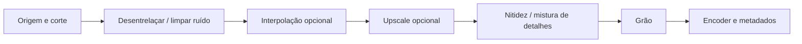

# Enhancement no FrameScale: viabilidade e proposta

Pesquisa e prova de execução: 16/09/2026. **Atualização de 19/09/2026:** o painel Enhancement foi implementado com denoise, nitidez, deblock, deband, grão e desentrelaçamento, incluindo projeto, fila, presets e comparação. A revisão seguinte integrou os modelos locais Real-ESRGAN Plus, Plus Anime e Real-CUGAN SE ao painel, com restauração em 1×. Não foram baixados modelos novos. Mistura de detalhes e motores temporais continuam como propostas. A pesquisa original e suas limitações são mantidas abaixo.

## Conclusão

É viável acrescentar redução de ruído, nitidez, redução de artefatos de compressão, grão e mistura de detalhes da origem. A primeira versão pode usar o FFmpeg já distribuído e o Real-CUGAN existente. Para restauração que considere o movimento entre fotogramas, a opção que recomendo investigar primeiro é RealBasicVSR/BasicVSR++; exige um motor adicional e testes de GPU. Essa recomendação é uma decisão de engenharia baseada nas capacidades e dependências abaixo, não um resultado de comparação de qualidade com Topaz.

A interface do Topaz reúne funções diferentes. A documentação distingue modelos e modos Auto/Relative/Manual; Recover Detail mistura informação da origem, Add Noise introduz ruído e Focus Fix usa redução seguida de ampliação. Portanto, copiar os nomes dos controles não produziria o mesmo processamento. [Documentação de Enhancement do Topaz](https://docs.topazlabs.com/video-ai/filters/enhancement).

## O que dá para implementar com o runtime atual

| Controle proposto | Implementação candidata | Limite que a interface deve explicar |
| --- | --- | --- |
| Reduzir ruído | `hqdn3d`, ou denoising do Real-CUGAN para anime | Intensidade alta pode apagar textura; CUGAN depende do modelo/escala |
| Nitidez | `cas` ou `unsharp` | Pode acentuar halos e ruído |
| Reduzir blocos | `deblock` | Não reconstrói toda a informação perdida na compressão |
| Suavizar banding | `deband` | Precisa ser comparado em gradientes reais |
| Preservar detalhe original | `blend` entre origem alinhada e resultado | Também pode trazer ruído e defeitos de volta |
| Grão | `noise` com intensidade controlada | Ruído procedural, não um modelo de película |
| Desentrelaçar | `bwdif`, com ordem de campos e cadência explícitas | Só aplicar a material entrelaçado |

As funções dos filtros estão descritas na [documentação oficial do FFmpeg](https://ffmpeg.org/ffmpeg-filters.html). Os efeitos colaterais e a seleção para a interface acima são a minha avaliação; esses valores ainda não são presets de produção. O suporte a denoising e os modelos do CUGAN vêm do [projeto oficial Real-CUGAN](https://github.com/bilibili/ailab/blob/main/Real-CUGAN/README_EN.md).

### Prova local, reproduzível

Execute, dentro de `FrameScale`:

```powershell
python tests/probe-enhancement-filters.py
```

O script cria uma fonte sintética de 320×180, 12 fps e dois segundos, com ruído e compressão. Executa sete casos: denoise, sharpen, deblock, deband, grain, deinterlace e detail-blend. Cada resultado precisa conservar 24 fotogramas, dimensões e duração, e passar pela decodificação integral. O hash dos pixels é comparado ao da origem.

**Resultado local: 7/7 passaram, todos alteraram os pixels.** Evidência: `build/enhancement-probe-a4retemb/report.json`. A execução dos filtros levou de 0,031 a 0,038 s por caso nesse fixture pequeno. Esses tempos incluem a chamada de FFmpeg e **não estimam velocidade em 4K/8K**. A fonte de desentrelaçamento é sintética; o teste comprova execução, não qualidade em material entrelaçado real. Não foram medidos PSNR, SSIM, LPIPS, flicker nem comparações com Topaz.

## Motores de IA avaliados

| Motor | O que acrescentaria | Integração e decisão |
| --- | --- | --- |
| Real-ESRGAN General x4v3 | Restauração geral com intensidade de denoising | O projeto Python oferece `-dn`. O runner ncnn empacotado não oferece essa opção nem esse modelo no seu catálogo de ajuda. Precisa de outro runner/conversão validada; não basta adicionar um slider. Código BSD-3-Clause. [Real-ESRGAN](https://github.com/xinntao/Real-ESRGAN), [runner ncnn](https://github.com/xinntao/Real-ESRGAN-ncnn-vulkan) |
| Real-CUGAN | Redução de ruído e upscale orientados a anime | Já integrado. É o caminho de menor alteração para presets de anime; aproveitar o catálogo de níveis realmente suportados. Código/modelos publicados no projeto com licença MIT. [README](https://github.com/bilibili/ailab/blob/main/Real-CUGAN/README_EN.md), [licença](https://github.com/bilibili/ailab/blob/main/Real-CUGAN/LICENSE) |
| RealBasicVSR | Super-resolução de vídeos reais usando informação temporal | Candidato principal para uma segunda fase. Python/PyTorch, MMCV/MMEditing e controle de comprimento da sequência. Código Apache-2.0; dependências antigas exigem ambiente isolado e validação no Windows. [Repositório oficial](https://github.com/ckkelvinchan/RealBasicVSR) |
| BasicVSR++ | Restauração temporal, incluindo checkpoints de denoise/deblur | Complementa RealBasicVSR. Não é um arquivo `.ncnn` que possa ser colocado no runner atual. Código Apache-2.0; PyTorch/MMCV e operadores próprios precisam ser empacotados e testados. [Repositório oficial](https://github.com/ckkelvinchan/BasicVSR_PlusPlus) |
| NAFNet | Denoise e deblur de imagens | Alternativa para fotos. Aplicar separadamente a cada fotograma pode causar variação temporal: essa é uma inferência arquitetural, ainda não medida aqui. Código Apache-2.0. [Projeto](https://github.com/megvii-research/NAFNet), [licença](https://github.com/megvii-research/NAFNet/blob/main/LICENSE) |
| RVRT | Super-resolução, deblur e denoise de vídeo | Interessante para pesquisa, mas o projeto usa majoritariamente CC-BY-NC. A referência de instalação usa Ubuntu/CUDA/PyTorch; não recomendaria incluí-lo como motor padrão de um produto comercial sem resolver a licença e o suporte Windows. [Projeto e licença](https://github.com/JingyunLiang/RVRT#license-and-acknowledgement) |
| CodeFormer | Restauração de faces | Uso opcional e específico, com atenção a alterações de detalhes faciais. A licença S-Lab 1.0 permite os usos não comerciais descritos e pede contato para uso comercial. Não selecionar como dependência padrão. [Projeto](https://github.com/sczhou/CodeFormer), [licença oficial](https://github.com/sczhou/CodeFormer/blob/master/LICENSE) |

As licenças acima descrevem os repositórios consultados; a distribuição de cada checkpoint, dependência e binário ainda precisa ser conferida individualmente antes de integrar um novo pacote. Nenhum desses novos motores foi instalado ou executado nesta pesquisa.

### Usar os próprios modelos do Topaz

Existe uma integração tecnicamente possível com uma instalação externa do Topaz: a documentação apresenta um FFmpeg próprio, filtros `tvai_up`/`tvai_fi`, diretórios de modelos e autenticação criada pelo aplicativo. O FFmpeg normal do FrameScale não contém esses filtros. Isso seria um adaptador opcional para quem já possui o Topaz instalado/autenticado, sujeito às suas condições de uso; não autorizaria redistribuir os modelos dentro do FrameScale. [CLI oficial do Topaz](https://docs.topazlabs.com/video-ai/advanced-functions-in-topaz-video-ai/command-line-interface).

## Como integrar sem tornar o programa pesado

Proposta original de arquitetura. A primeira etapa com filtros FFmpeg já foi aplicada; os itens sobre novos motores e análise automática continuam futuros:

1. Criar `EnhancementOptions` com valores tipados e limites. Salvar a mesma estrutura no projeto, no preset e no snapshot da fila. Cada motor informa quais controles realmente suporta.
2. Começar com filtros manuais desligados por padrão. Presets Leve/Médio podem ter parâmetros definidos; um modo Automático só deve aparecer depois de existir análise real do conteúdo.
3. Usar um processo separado para inferência. Carregar modelos quando necessários, manter apenas um job de GPU ativo e limitar tiles, fila de frames e janela temporal. Não carregar PyTorch no início da interface Qt.
4. Fazer comparação e exportação usarem exatamente a mesma configuração. A comparação de dois segundos adicionada nesta revisão já usa `ProcessingJob`, inclusive RIFE e upscale reais, em vez de simular o efeito visual.
5. Processar em 1× quando a tarefa for somente restauração. Não passar por um modelo de upscale 4× sem necessidade.

Ordem inicial proposta para filtros separáveis:



Essa ordem é uma hipótese a validar com movimento real. Um modelo como CUGAN já une denoising e upscale; não devemos executá-lo duas vezes para simular duas etapas. A mistura com o original precisa alinhar resolução, cadência, corte, cor e timestamps.

O computador usado tem GTX 1070 com 8 GiB de VRAM. Um único fotograma RGB float32 de 7680×4320 ocupa aproximadamente 380 MiB, antes das ativações do modelo; 60 deles ultrapassam 22 GiB. Esse cálculo torna inadequado colocar um trecho inteiro de 8K na GPU. É preciso medir pico de memória, usar tiles/janelas e validar uma versão de runtime que suporte essa GPU. Não há garantia de que um modelo temporal grande caiba ou seja rápido nela.

### Critérios para liberar o Enhancement

- Comparar cenas estáticas e movimento, anime, pele, texto, grão e cortes; avaliar flicker e halos além de métricas por imagem.
- Validar saídas 1×, 1,5× e 2×, 4K/8K, com e sem interpolação, sem perda de áudio, CRF, metadados, cor ou precisão do corte.
- Cancelar durante cada etapa; falhas de memória devem produzir uma mensagem e liberar recursos, sem congelar a interface.
- Medir tempo e memória por resolução/modelo no hardware alvo. Os resultados do pequeno probe não substituem esse benchmark.

## Decisão para Output nesta revisão

O FrameScale oferece ProRes em QuickTime/MOV, H.264/H.265 em MP4/MKV/MOV e Motion JPEG/H.264 em AVI, com configurações de áudio próprias de cada saída. Isso segue a organização por formato e módulo de saída do [After Effects](https://helpx.adobe.com/after-effects/desktop/render-and-export/basics-of-rendering-and-exporting/basics-rendering-exporting.html). É uma política de compatibilidade do aplicativo: Matroska tecnicamente admite ProRes, como documenta o identificador `V_PRORES` na [especificação oficial](https://www.matroska.org/technical/codec_specs.html).


## Revisão de restauração — 19/09/2026

O painel agora seleciona uma restauração real, inclusive quando o Filtro está desligado ou em 1×. O modelo usa sua escala nativa e o resultado é redimensionado para as dimensões solicitadas. A seleção também é usada no upscale para evitar duas passagens de IA. Foram adicionados três perfis fixos e ajuste manual; não há um modo automático que finja analisar a mídia.

A referência Original da comparação lê o próprio arquivo de entrada e usa um deslocamento temporal para coincidir com o trecho processado. A comparação não reduz os dois lados a proxies 720p; decodifica os frames nativos. Apenas um codec que não possa ser reproduzido pelo Qt usa fallback lossless de 8 bits. Isso não constitui certificação de monitoramento HDR.

Fontes consultadas nesta revisão: [controles e limites do Enhancement do Topaz](https://docs.topazlabs.com/topaz-video/filters/enhancement) e [modelos suportados pelo Real-ESRGAN NCNN](https://github.com/xinntao/Real-ESRGAN-ncnn-vulkan). A escolha dos perfis e a calibração da redução de ruído são decisões do FrameScale, não parâmetros equivalentes a Proteus/Iris/Starlight.
