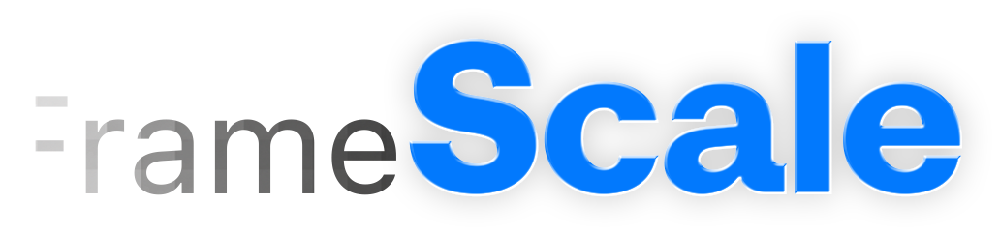
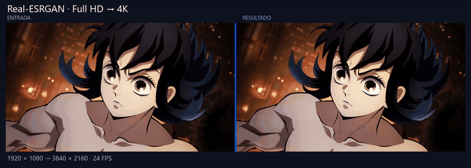
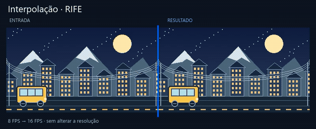
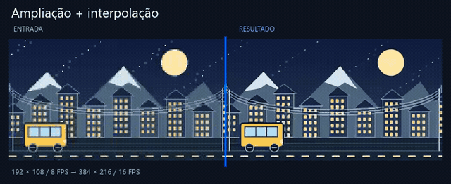
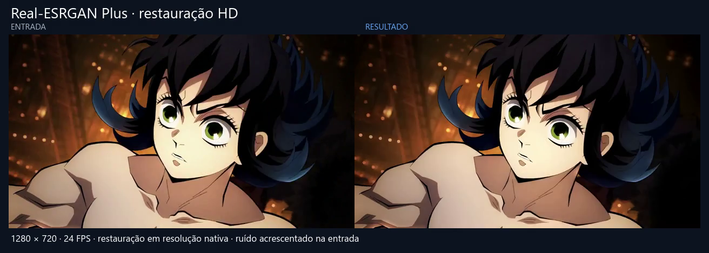
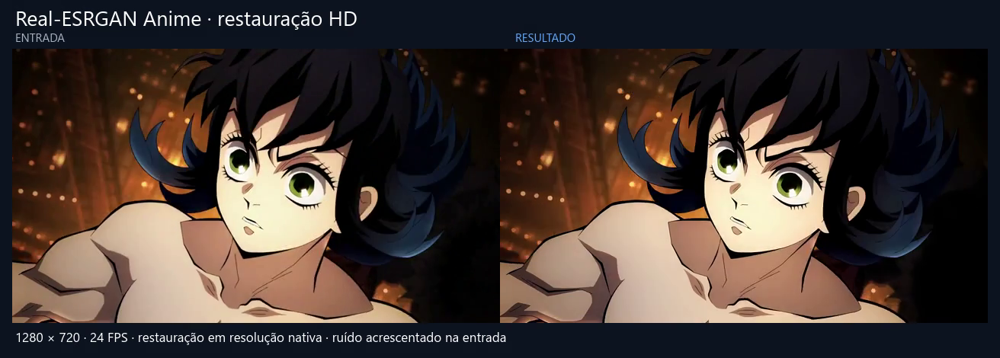
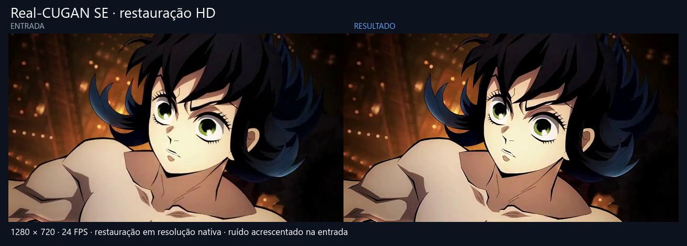

<div align="center">


<br />


**Amplie, restaure e interpole vídeos e imagens com inteligência artificial.**

<a href="https://github.com/brenomg77/FrameScale/releases/tag/v0.1.0-alpha.1"></a>
<a href="https://github.com/brenomg77/FrameScale/releases/download/v0.1.0-alpha.1/FrameScale-0.1.0-Windows-x64-Setup.exe"></a>
<a href="https://github.com/brenomg77/FrameScale/releases"></a>
<a href="FrameScale/README.md"></a>
<a href="FrameScale/THIRD_PARTY_NOTICES.md"></a>

</div>


---

<p align="center">
  <a href="#-instalação">Instalação</a> ·
  <a href="#-funcionalidades">Funcionalidades</a> ·
  <a href="#-como-usar">Como usar</a> ·
  <a href="#-requisitos">Requisitos</a> ·
  <a href="#-documentação">Documentação</a> ·
  <a href="#-desenvolvimento">Desenvolvimento</a>
</p>

## 🌟 Versão 0.1.0 Alpha 1

A versão de teste para Windows reúne ampliação e restauração com IA, interpolação, projetos com camadas e comparação de resultados. Os ajustes recentes incluem atalhos personalizáveis, refinamentos do tema Liquid Glass e correções das prévias de intervalos curtos.

[Baixar a versão de teste](https://github.com/brenomg77/FrameScale/releases/tag/v0.1.0-alpha.1) · [Ver demonstrações](docs/DEMOS.md)

## ✨ Sobre o FrameScale

O **FrameScale** é uma aplicação para Windows que reúne edição, ampliação, restauração e interpolação de vídeos e imagens em uma interface gráfica. Abra um arquivo, ajuste o processamento, compare o resultado na prévia e exporte pela fila.

O projeto é desenvolvido em **C++ e Qt** como parte de uma Prova de Aptidão Profissional (PAP). A interface, a integração dos motores, os projetos, a fila e o fluxo de processamento são desenvolvidos no FrameScale; os modelos de inteligência artificial pertencem aos projetos indicados abaixo.

> **Versão alpha:** o FrameScale está em desenvolvimento. A versão disponível para download é experimental; reporte problemas com os passos necessários para reproduzi-los.

## 🪟 Instalação

### Windows x64

**[⬇ Baixar o instalador do FrameScale](https://github.com/brenomg77/FrameScale/releases/download/v0.1.0-alpha.1/FrameScale-0.1.0-Windows-x64-Setup.exe)**

1. Baixe `FrameScale-0.1.0-Windows-x64-Setup.exe` na [página da release](https://github.com/brenomg77/FrameScale/releases/tag/v0.1.0-alpha.1).
2. Execute o instalador e escolha a pasta de instalação.
3. Abra o FrameScale pelo atalho criado pelo instalador.

O pacote inclui **Qt, FFmpeg, ferramentas de processamento e modelos de IA**. Para usar o programa, basta instalar esse pacote; a preparação de um ambiente de desenvolvimento é opcional.

O instalador ainda não possui assinatura digital de editor. O arquivo `.sha256` publicado junto ao download permite conferir a integridade do pacote. Os arquivos **Source code** disponibilizados pelo GitHub são destinados ao desenvolvimento.

## ⚙️ Funcionalidades

| Área | O que você pode fazer |
| :--- | :--- |
| **Ampliação** | Aumentar a resolução de imagens, vídeos e GIFs com Real-ESRGAN, Real-CUGAN ou Anime4K; escolher a escala final, incluindo valores fracionários. |
| **Restauração** | Usar modelos compatíveis para tratar imagens e vídeos com ruído ou compressão. |
| **Interpolação** | Criar frames intermediários com RIFE e combinar a interpolação com ampliação e corte. |
| **Ajustes de imagem** | Controlar redução de ruído, nitidez, blocos de compressão, faixas de cor, grão, contraste e intensidade das cores. |
| **Timeline** | Trabalhar com camadas de vídeo e áudio, cortar trechos, mover pistas, ajustar velocidade e escolher o intervalo de exportação. |
| **Prévia** | Comparar a origem com um trecho processado, navegar por frames e ajustar o zoom. |
| **Projetos e presets** | Alternar entre projetos em abas e guardar configurações em presets `.fspreset`. |
| **Fila de exportação** | Adicionar trabalhos com configurações independentes, acompanhar o progresso, pausar ou cancelar o processamento. |
| **Abrir por URL** | Baixar vídeos de serviços compatíveis e imagens por links diretos. |
| **Personalização** | Escolher idioma e aparência, configurar atalhos e restaurar as combinações originais. |

### Motores de processamento

| Motor | Utilização no FrameScale |
| :--- | :--- |
| [Real-ESRGAN](https://github.com/xinntao/Real-ESRGAN) | Ampliação e restauração, com modelos voltados a conteúdo real e anime. |
| [Real-CUGAN](https://github.com/bilibili/ailab/tree/main/Real-CUGAN) | Ampliação e restauração de anime e ilustrações. |
| [Anime4K](https://github.com/bloc97/Anime4K) | Processamento com shaders por meio de mpv/libplacebo. |
| [RIFE](https://github.com/hzwer/ECCV2022-RIFE) | Interpolação de frames de vídeo. |
| [FFmpeg](https://ffmpeg.org/) | Leitura, composição, filtros, áudio e codificação dos arquivos. |

O resultado depende do material de origem, do modelo e dos ajustes escolhidos. Use a prévia para comparar detalhes antes de processar o arquivo completo.

## 🎬 Demonstrações

Comparações geradas pelo processamento real do FrameScale com cenas de teste próprias e um trecho de vídeo fornecido pelo usuário. Clique nas prévias para abrir os vídeos. A [galeria completa](docs/DEMOS.md) reúne **25 demonstrações**, com parâmetros e arquivos de origem.

### 🔍 Ampliação de resolução

[](docs/media/upscale-esrgan.mp4)

**Full HD → 4K UHD (3840 × 2160).** [▶ Comparar Real-ESRGAN](docs/media/upscale-esrgan.mp4) · [▶ Comparar Real-CUGAN](docs/media/upscale-cugan.mp4) · [▶ Comparar Anime4K](docs/media/upscale-anime4k.mp4)

Saídas completas em 4K: [Real-ESRGAN](docs/media/upscale-esrgan-full.mp4) · [Real-CUGAN](docs/media/upscale-cugan-full.mp4) · [Anime4K](docs/media/upscale-anime4k-full.mp4)

### 🎞️ Interpolação de frames

[](docs/media/interpolation.mp4)

**Full HD de 24 FPS para 60 e 120 FPS com RIFE.** [▶ Comparar 60 FPS](docs/media/interpolation-60.mp4) · [▶ Comparar 120 FPS](docs/media/interpolation.mp4)

Saídas completas: [Full HD a 60 FPS](docs/media/interpolation-60-full.mp4) · [Full HD a 120 FPS](docs/media/interpolation-full.mp4)

### ✨ 4K a 120 FPS

[](docs/media/combined.mp4)

**1920 × 1080 / 24 FPS → 3840 × 2160 / 120 FPS.** [▶ Comparar entrada e saída](docs/media/combined.mp4) · [▶ Abrir o resultado completo em 4K a 120 FPS](docs/media/combined-full.mp4)

Também disponível: [resultado em 4K a 60 FPS](docs/media/fps-reduction-full.mp4), produzido pela redução de FPS do FrameScale.

Os GIFs são prévias leves a **12 FPS**; a prévia da interpolação usa câmera lenta de 4× para mostrar os frames intermediários. Para conferir 60 ou 120 FPS em velocidade normal, abra o MP4 correspondente; o player e a tela também precisam suportar a cadência escolhida.

### 🧩 Modelos de restauração

Os três modelos abaixo processam o mesmo trecho de vídeo HD com ruído acrescentado para demonstração, mantendo **1280 × 720 a 24 FPS**. Clique na imagem para comparar entrada e resultado.

| Real-ESRGAN Plus | Real-ESRGAN Anime | Real-CUGAN SE |
| :---: | :---: | :---: |
| [](docs/media/restore-plus.mp4) | [](docs/media/restore-anime.mp4) | [](docs/media/restore-cugan.mp4) |
| [▶ Comparação](docs/media/restore-plus.mp4) · [Saída HD](docs/media/restore-plus-full.mp4) | [▶ Comparação](docs/media/restore-anime.mp4) · [Saída HD](docs/media/restore-anime-full.mp4) | [▶ Comparação](docs/media/restore-cugan.mp4) · [Saída HD](docs/media/restore-cugan-full.mp4) |

### 🎛️ Mais recursos em vídeo

| Recurso | Demonstrações |
| :--- | :--- |
| **Filtros de imagem** | [Ruído](docs/media/denoise.mp4) · [Nitidez](docs/media/sharpen.mp4) · [Blocos](docs/media/deblock.mp4) · [Faixas de cor](docs/media/deband.mp4) · [Grão](docs/media/grain.mp4) · [Contraste](docs/media/contrast.mp4) · [Cores](docs/media/vibrance.mp4) |
| **Timeline e movimento** | [Corte](docs/media/trim.mp4) · [Velocidade](docs/media/speed.mp4) · [Redução de FPS](docs/media/fps-reduction.mp4) · [Camadas](docs/media/layers.mp4) |
| **Orientação** | [Rotação](docs/media/rotate.mp4) · [Espelhamento](docs/media/flip.mp4) |
| **Exportação** | [Áudio](docs/media/audio.mp4) · [GIF](docs/media/gif.mp4) · [Sequência de imagens](docs/media/sequence.mp4) |

[**Abrir a galeria com todas as prévias animadas →**](docs/DEMOS.md)

## 🚀 Como usar

1. **Abra o arquivo.** Arraste uma imagem ou vídeo para a janela de boas-vindas, use **Abrir** ou escolha **Abrir por URL**.
2. **Prepare o trecho.** Ajuste os limites na timeline e organize as camadas de vídeo e áudio.
3. **Escolha o processamento.** Ative ampliação, interpolação ou melhoria de imagem e selecione os modelos e parâmetros.
4. **Compare na prévia.** Clique em **Preview** para conferir o intervalo selecionado antes da exportação.
5. **Configure a saída.** Na aba de codificação, escolha o formato, o codec e as opções disponíveis.
6. **Exporte.** Adicione o trabalho à fila e acompanhe o progresso.

### Escolhendo os ajustes

- **Mais resolução:** comece pela ampliação e compare os modelos disponíveis para o seu tipo de conteúdo.
- **Movimento mais fluido:** use interpolação. Ela exige pelo menos dois frames de origem.
- **Imagem com ruído ou compressão:** experimente a restauração ou os filtros, aumentando a intensidade aos poucos.
- **Somente corte, velocidade ou conversão:** configure a timeline e a saída conforme necessário.

A prévia processada usa intermediários sem perda e serve para comparar o processamento. A compressão final depende das opções de codificação escolhidas para a exportação.

## 📦 Formatos

| Tipo | Formatos disponíveis |
| :--- | :--- |
| **Imagens individuais** | PNG, JPEG, WebP e BMP |
| **Vídeo** | MP4, MKV, MOV e AVI |
| **Animação** | GIF |
| **Áudio** | MP3 e WAV |
| **Sequência de imagens** | PNG e JPEG |

As opções de codec e de áudio dependem do formato selecionado. A exportação de vídeo utiliza uma cadência constante de frames (CFR); entradas com cadência variável são normalizadas pelo processamento.

## 🖥️ Requisitos

| Componente | Requisito |
| :--- | :--- |
| **Sistema** | Windows x64 — plataforma da distribuição validada |
| **GPU** | GPU e driver com suporte a Vulkan para os motores de IA |
| **Armazenamento** | Espaço para o programa, os modelos, os arquivos temporários e a saída |
| **Internet** | Necessária para baixar o instalador e usar a abertura por URL |

O tempo de processamento e o uso de memória variam conforme a resolução, a duração, o modelo e a GPU. O processamento de arquivos locais utiliza as ferramentas distribuídas com o instalador.

**Idiomas:** português de Portugal, português do Brasil e inglês.

**Aparência:** Liquid Glass claro, Liquid Glass escuro e Estúdio.

## 📖 Documentação

| Guia | Conteúdo |
| :--- | :--- |
| [Documentação do projeto](FrameScale/README.md) | Compilação, processamento, validação e estrutura técnica |
| [Instalador Windows](FrameScale/docs/windows-installer.md) | Empacotamento e verificação do instalador |
| [Abertura por URL](FrameScale/docs/url-downloads.md) | Comportamento, serviços e limites dos downloads |
| [Manifesto de dependências](FrameScale/runtime/manifest.json) | Arquivos, versões e hashes das ferramentas e modelos |
| [Avisos de terceiros](FrameScale/THIRD_PARTY_NOTICES.md) | Licenças, atribuições e proveniência das dependências |

## 💡 Perguntas frequentes

<details>
<summary><strong>Preciso instalar Python ou Qt para usar o FrameScale?</strong></summary>

O instalador Windows inclui as dependências de execução. Python, Qt Creator e CMake são ferramentas de desenvolvimento e não são necessários para usar a aplicação instalada.

</details>

<details>
<summary><strong>Por que a prévia mostra uma resolução diferente da origem?</strong></summary>

A visualização das camadas pode usar uma cópia reduzida para tornar a navegação mais leve. O processamento das camadas para exportação utiliza as fontes originais.

</details>

<details>
<summary><strong>Um frame é o mesmo que um segundo?</strong></summary>

Um vídeo de 30 FPS contém 30 frames por segundo. Na timeline, `00:00.01` representa um frame e `00:01.00` representa um segundo: o campo após o ponto indica os frames dentro daquele segundo.

</details>

<details>
<summary><strong>O programa atualiza automaticamente?</strong></summary>

A atualização dentro do programa ainda não está implementada. Consulte a página de releases para baixar o instalador atualizado.

</details>

## 🛠️ Desenvolvimento

O código da aplicação fica em [`FrameScale/`](FrameScale/). O projeto utiliza **C++17, Qt 6, CMake e Ninja**; a compilação Windows validada usa Qt 6.11.2 e MinGW 13.1.

Consulte as [instruções de compilação e testes](FrameScale/README.md) para preparar o ambiente.

<details>
<summary><strong>Preparar ferramentas e modelos para desenvolvimento</strong></summary>

Os binários e modelos estão no instalador, mas são ignorados pelo Git. Depois de instalar o programa, copie:

| Pasta da instalação | Destino no projeto |
| :--- | :--- |
| `bin/runtime/bin` | `FrameScale/runtime/bin` |
| `bin/models` | `FrameScale/models` |

Confira a integridade dos arquivos:

```powershell
cd FrameScale
powershell -NoProfile -File scripts/verify-runtime.ps1
```

Os arquivos esperados e seus hashes estão no [manifesto de dependências](FrameScale/runtime/manifest.json).

</details>

### Reportar problemas e sugerir melhorias

Abra uma [issue](https://github.com/brenomg77/FrameScale/issues) e inclua a versão do FrameScale, as configurações usadas, o comportamento esperado e os passos para reproduzir o problema. Para falhas de processamento, informe também a GPU, o modelo selecionado e as características do arquivo de origem.

## ⚖️ Licenças e créditos

O FrameScale integra ferramentas e modelos de terceiros que mantêm suas próprias licenças. As atribuições e os limites de proveniência estão nos [avisos de terceiros](FrameScale/THIRD_PARTY_NOTICES.md).

O código próprio do FrameScale ainda não possui uma licença definida.

Obrigado aos projetos **Qt, FFmpeg, Real-ESRGAN, Real-CUGAN, Anime4K, RIFE, ncnn, mpv, libplacebo, yt-dlp e Deno**, que fornecem componentes utilizados pelo programa.
