# 🎬 Demonstrações do FrameScale

Comparações produzidas pelo fluxo de processamento do FrameScale. Clique nas imagens para abrir os vídeos comparativos ou use os links de **saída completa**, que mantêm a resolução e os FPS anunciados.

## 🚀 Demonstrações em alta resolução

| Recurso | Entrada | Saída completa |
| :--- | :--- | :--- |
| Real-ESRGAN | Full HD, 24 FPS | [4K UHD, 24 FPS](media/upscale-esrgan-full.mp4) |
| Real-CUGAN | Full HD, 24 FPS | [4K UHD, 24 FPS](media/upscale-cugan-full.mp4) |
| Anime4K | Full HD, 24 FPS | [4K UHD, 24 FPS](media/upscale-anime4k-full.mp4) |
| RIFE | Full HD, 24 FPS | [Full HD, 60 FPS](media/interpolation-60-full.mp4) |
| RIFE | Full HD, 24 FPS | [Full HD, 120 FPS](media/interpolation-full.mp4) |
| Real-ESRGAN + RIFE | Full HD, 24 FPS | [4K UHD, 120 FPS](media/combined-full.mp4) |
| Redução de FPS | 4K UHD, 120 FPS | [4K UHD, 60 FPS](media/fps-reduction-full.mp4) |
| Restauração Plus | HD com ruído, 24 FPS | [HD restaurado, 24 FPS](media/restore-plus-full.mp4) |
| Restauração Anime | HD com ruído, 24 FPS | [HD restaurado, 24 FPS](media/restore-anime-full.mp4) |
| Restauração CUGAN SE | HD com ruído, 24 FPS | [HD restaurado, 24 FPS](media/restore-cugan-full.mp4) |

## 🧪 Fontes e apresentação

Os exemplos de alta resolução usam um trecho fornecido pelo usuário, extraído de **Demon Slayer - S4E08 (120).mp4**. O trecho foi preparado em Full HD a 24 FPS para comparar os motores sobre a mesma entrada. Os créditos e direitos do conteúdo de origem pertencem aos seus respectivos titulares.

Os filtros, corte, velocidade, orientação, camadas e formatos de exportação também incluem a ilustração sintética criada para esta documentação. Ela permite reproduzir exemplos curtos com movimento, detalhes, ruído e gradientes.

As saídas foram geradas pelo `ProcessingJob` do FrameScale, com o executável de validação `FrameScaleProcessingSmoke`. O FFmpeg montou as comparações e legendas depois do processamento. São demonstrações de resultados, não gravações dos controles da interface.

**Os GIFs são prévias reduzidas a 12 FPS nos novos exemplos e a 8 FPS nos exemplos sintéticos.** Os GIFs de interpolação usam câmera lenta de 4× para evidenciar os frames intermediários. Os vídeos comparativos são redimensionados para leitura no navegador; os arquivos `-full.mp4` mantêm a resolução de saída e os FPS anunciados. Para avaliar 60 ou 120 FPS em velocidade normal, use o MP4 completo em um player e uma tela compatíveis. Os MP4 de saída usam H.264 com CRF 18.

Nos exemplos com durações diferentes, a montagem repete os trechos para completar a apresentação. Estes exemplos não são um benchmark; o resultado e o tempo de processamento dependem da fonte, do modelo e do equipamento.

## 📥 Arquivos de origem e parâmetros

- [Trecho Full HD — 1920 × 1080, 24 FPS](media/source-fullhd-24fps.mp4)
- [Entrada HD com ruído — restauração](media/source-hd-noisy.mp4)
- [Cena sintética — 384 × 216, 8 FPS](media/source-384x216-8fps.mp4)
- [Entrada sintética reduzida — 192 × 108, 8 FPS](media/source-192x108-8fps.mp4)
- [Entrada sintética com ruído](media/source-noisy.mp4)
- [Entrada sintética com faixas de cor](media/source-bands.mp4)
- [Metadados de resolução, FPS e número de frames](media/manifest.json)

<details>
<summary><strong>Reproduzir em um ambiente de desenvolvimento</strong></summary>

Os [scripts de geração](scripts/) usam Python, Pillow e a compilação de desenvolvimento `Desktop_Qt_6_11_2_MinGW_64_bit_Debug`, com `FrameScaleProcessingSmoke`, ferramentas e modelos completos. Ajuste os caminhos de Qt conforme seu ambiente.

```powershell
python docs/scripts/build_readme_demos.py
python docs/scripts/finish_readme_demos.py
python docs/scripts/build_4k_demos.py
python docs/scripts/build_hd_restore_demos.py
python docs/scripts/build_4k60_demo.py
```

Os arquivos de origem publicados permitem repetir o processamento. Para preparar um novo trecho Full HD, defina `FRAMESCALE_DEMO_SOURCE` com o caminho do vídeo desejado. Logs e intermediários ficam na pasta de build.

</details>


## 🔍 Ampliação

### Real-ESRGAN · Full HD → 4K

1920 × 1080 → 3840 × 2160 · 24 FPS

[](media/upscale-esrgan.mp4)

[▶ Comparar entrada e resultado](media/upscale-esrgan.mp4) · [▶ Saída completa](media/upscale-esrgan-full.mp4)

### Real-CUGAN · Full HD → 4K

1920 × 1080 → 3840 × 2160 · 24 FPS

[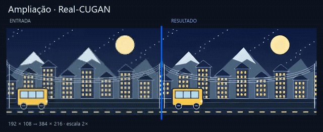](media/upscale-cugan.mp4)

[▶ Comparar entrada e resultado](media/upscale-cugan.mp4) · [▶ Saída completa](media/upscale-cugan-full.mp4)

### Anime4K · Full HD → 4K

1920 × 1080 → 3840 × 2160 · 24 FPS

[](media/upscale-anime4k.mp4)

[▶ Comparar entrada e resultado](media/upscale-anime4k.mp4) · [▶ Saída completa](media/upscale-anime4k-full.mp4)

### Real-ESRGAN + RIFE · 4K a 120 FPS

1080p / 24 FPS → 4K / 120 FPS

[](media/combined.mp4)

[▶ Comparar entrada e resultado](media/combined.mp4) · [▶ Saída completa](media/combined-full.mp4)

## 🎞️ Interpolação

### RIFE · Full HD a 60 FPS

1920 × 1080 · 24 FPS → 60 FPS

[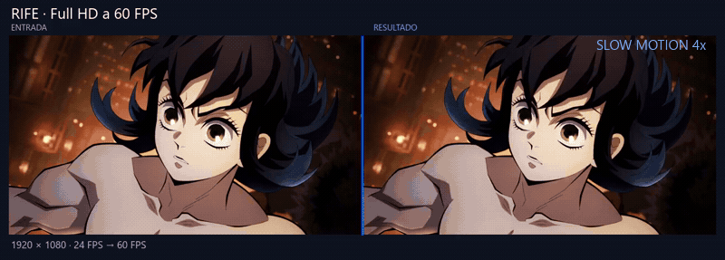](media/interpolation-60.mp4)

[▶ Comparar entrada e resultado](media/interpolation-60.mp4) · [▶ Saída completa](media/interpolation-60-full.mp4)

### RIFE · Full HD a 120 FPS

1920 × 1080 · 24 FPS → 120 FPS

[](media/interpolation.mp4)

[▶ Comparar entrada e resultado](media/interpolation.mp4) · [▶ Saída completa](media/interpolation-full.mp4)

## 🧩 Restauração

### Real-ESRGAN Plus · restauração HD

1280 × 720 · 24 FPS · restauração em resolução nativa · ruído acrescentado na entrada

[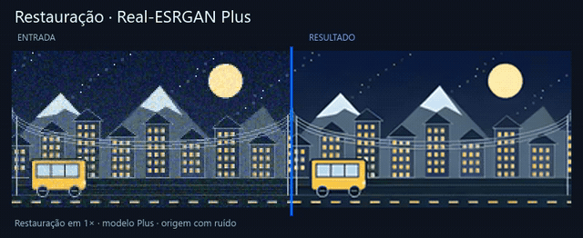](media/restore-plus.mp4)

[▶ Comparar entrada e resultado](media/restore-plus.mp4) · [▶ Saída completa](media/restore-plus-full.mp4)

### Real-ESRGAN Anime · restauração HD

1280 × 720 · 24 FPS · restauração em resolução nativa · ruído acrescentado na entrada

[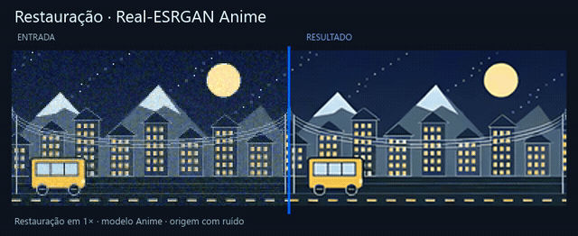](media/restore-anime.mp4)

[▶ Comparar entrada e resultado](media/restore-anime.mp4) · [▶ Saída completa](media/restore-anime-full.mp4)

### Real-CUGAN SE · restauração HD

1280 × 720 · 24 FPS · restauração em resolução nativa · ruído acrescentado na entrada

[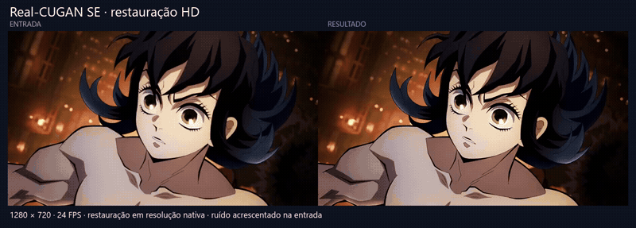](media/restore-cugan.mp4)

[▶ Comparar entrada e resultado](media/restore-cugan.mp4) · [▶ Saída completa](media/restore-cugan-full.mp4)

## 🎛️ Filtros de imagem

### Filtro · redução de ruído

Somente filtros · redução de ruído: 65

[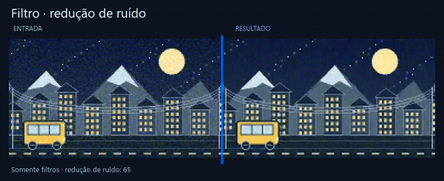](media/denoise.mp4)

[▶ Comparar entrada e resultado](media/denoise.mp4)

### Filtro · nitidez

Somente filtros · nitidez: 55

[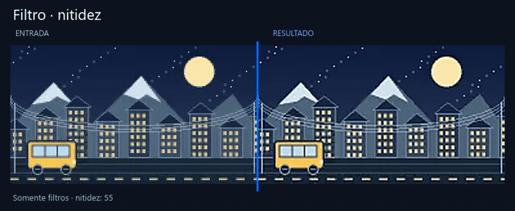](media/sharpen.mp4)

[▶ Comparar entrada e resultado](media/sharpen.mp4)

### Filtro · reduzir blocos

Somente filtros · reduzir blocos: 70

[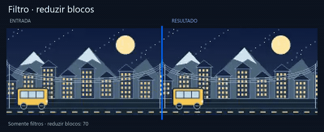](media/deblock.mp4)

[▶ Comparar entrada e resultado](media/deblock.mp4)

### Filtro · reduzir faixas de cor

Somente filtros · reduzir banding: 70

[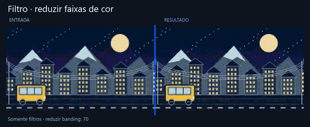](media/deband.mp4)

[▶ Comparar entrada e resultado](media/deband.mp4)

### Filtro · grão

Somente filtros · grão: 40

[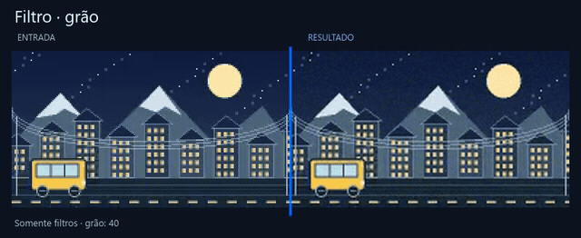](media/grain.mp4)

[▶ Comparar entrada e resultado](media/grain.mp4)

### Filtro · contraste

Somente filtros · contraste: +45

[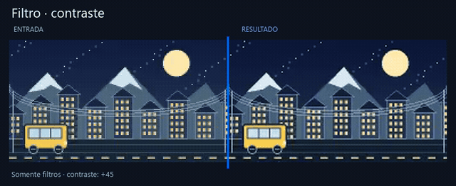](media/contrast.mp4)

[▶ Comparar entrada e resultado](media/contrast.mp4)

### Filtro · intensidade das cores

Somente filtros · intensidade das cores: +65

[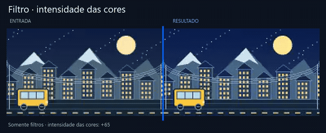](media/vibrance.mp4)

[▶ Comparar entrada e resultado](media/vibrance.mp4)

## ✂️ Timeline e movimento

### Corte na timeline

Intervalo: 1 s → 2 s · saída com 8 frames

[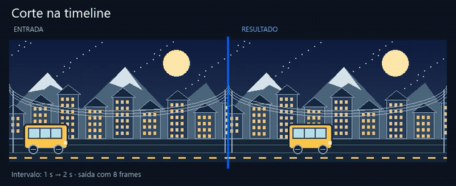](media/trim.mp4)

[▶ Comparar entrada e resultado](media/trim.mp4)

### Velocidade · movimento lento

Velocidade: 0,5× · saída com 6 segundos

[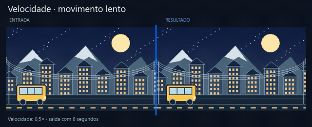](media/speed.mp4)

[▶ Comparar entrada e resultado](media/speed.mp4)

### Redução de FPS · 4K a 120 FPS → 4K a 60 FPS

3840 × 2160 preservado · 120 FPS → 60 FPS · mesma duração

[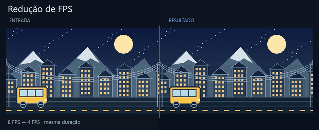](media/fps-reduction.mp4)

[▶ Comparar entrada e resultado](media/fps-reduction.mp4) · [▶ Saída completa](media/fps-reduction-full.mp4)

### Composição de camadas

Vídeo base + camada espelhada a partir de 1,5 s + áudio

[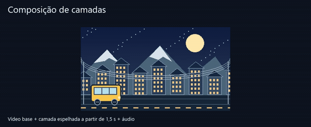](media/layers.mp4)

[▶ Comparar entrada e resultado](media/layers.mp4)

## 🔄 Orientação

### Rotação de vídeo

Rotação: 90° · conteúdo ajustado para esta comparação

[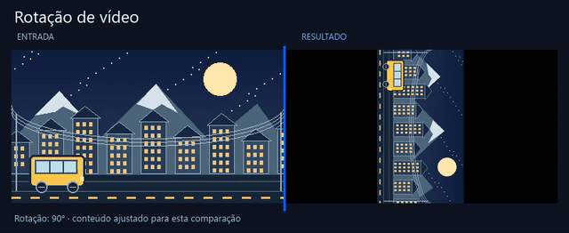](media/rotate.mp4)

[▶ Comparar entrada e resultado](media/rotate.mp4)

### Espelhamento de vídeo

Espelhamento horizontal

[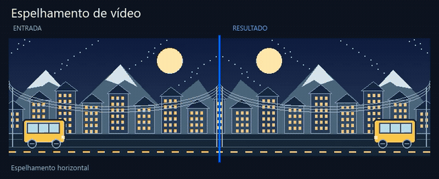](media/flip.mp4)

[▶ Comparar entrada e resultado](media/flip.mp4)

## 📦 Exportação

### Exportação de áudio

WAV exportado pelo FrameScale · visualização da onda de áudio

[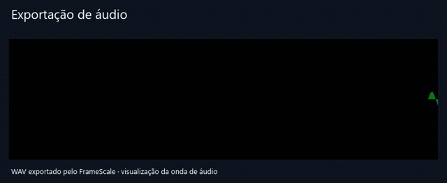](media/audio.mp4)

[▶ Comparar entrada e resultado](media/audio.mp4)

### Exportação em GIF

Animação GIF exportada pelo FrameScale

[](media/gif.mp4)

[▶ Comparar entrada e resultado](media/gif.mp4)

### Sequência de imagens

24 arquivos PNG exportados pelo FrameScale · 8 FPS

[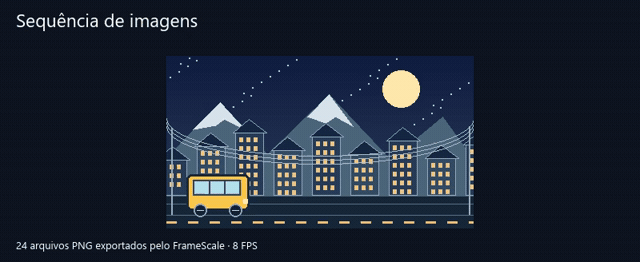](media/sequence.mp4)

[▶ Comparar entrada e resultado](media/sequence.mp4)
